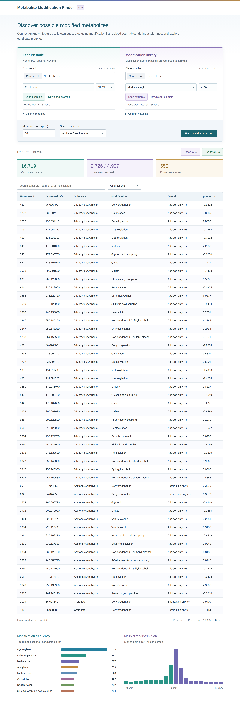

# Metabolite Modification Finder v1.0

Metabolite Modification Finder searches for possible modified metabolites using MS1 data and a list of mass differences. Features with a name are used as known substrates; features without a name are treated as unknowns.



*Positive-ion example, 10 ppm, addition and subtraction. The search returns 16,719 candidate matches.*

## Getting started

Download the ZIP file and extract it. Open `dist/index.html` in your browser. This works on Windows, Linux, and macOS. Keep the `dist` folder and its contents together. There is nothing to install, and the application works offline.

If you prefer to use a local server, open a terminal in the project folder and run:

```bash
python3 -m http.server 8080 --directory dist
```

Then visit <http://localhost:8080>. This option requires Python 3. On Windows, you may need to use `py -3` in place of `python3`.

## Running an analysis

1. Upload your data under **Feature table**, or select a positive- or negative-ion example and click **Load example**.
2. Upload a **Modification library**, or load the example provided. Both inputs accept XLSX, XLS, and CSV files. If your column names differ from the examples, select the appropriate columns under **Column mapping**.
3. Set the mass tolerance and search direction, then click **Find candidate matches**. The default tolerance is 10 ppm.
4. Review the candidate table and the **Modification frequency** and **Mass error distribution** plots. Use **Export CSV** or **Export XLSX** to save the results.

CSV contains the candidate table. XLSX also includes the analysis settings, summaries, and mapped input data. Both formats export all candidates, even when the table is filtered.

## Example data

The feature tables and modification list used in the manuscript are included below. You can also download them from the application.

| Dataset | Excel | CSV |
| --- | --- | --- |
| Positive-ion features | [Positive.xlsx](dist/examples/Positive.xlsx) | [Positive.csv](dist/examples/Positive.csv) |
| Negative-ion features | [Negative.xlsx](dist/examples/Negative.xlsx) | [Negative.csv](dist/examples/Negative.csv) |
| Modification library | [Modification_List.xlsx](dist/examples/Modification_List.xlsx) | [Modification_List.csv](dist/examples/Modification_List.csv) |

The Excel files are unchanged copies of the original inputs. Each CSV contains all columns from the first worksheet.

## How matching works

The feature table needs a **Name** column and an **m/z** column. The modification list needs a modification name and a positive mass difference. Feature IDs, retention times, and formulas are optional.

For each known substrate, the program adds or subtracts a modification mass and compares the predicted m/z with the observed m/z of unknown features:

```text
predicted m/z = substrate m/z ± modification mass
ppm error = (observed m/z − predicted m/z) / observed m/z × 10⁶
```

Here, **observed m/z is the measured m/z of the unknown feature**. A match is kept when the absolute ppm error is within the selected tolerance.

These matches are candidates for further investigation, not confirmed identifications. The program does not convert charges or adducts, or filter matches by retention time.

The original Python scripts are in `legacy/` for reference. Their matching rules differ from the web application, and they require separate substrate workbooks that are not included.
